<!--
  ZAIN ALI — GitHub Profile README (v3 · "Aurora")
  Repo: https://github.com/Malik-Zain-555/Malik-Zain-555
  Upload this README.md, the /assets folder, and /.github/workflows/snake.yml to the repo root.
  Visuals are custom animated SVGs generated by build_assets.py (edit the data, re-run, push).
-->

 

  

 

<!-- ───────────────────────── 01 · ABOUT ───────────────────────── -->

<table>
  <tr>
    <td width="60%" valign="top"></td>
    <td width="40%" valign="top">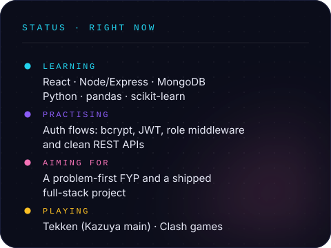</td>
  </tr>
</table>

Hey, I'm **Zain Ali**, a BSCS student at **Riphah International University, Pakistan**.
I build for the web, work out how systems behave behind the UI, and turn everyday annoyances into ideas for useful software.
Home base is **JavaScript & web development**, with a growing foundation in **Python, data analysis, and machine learning**.

🧭 **Honest-progress policy:** every skill below is labelled for where I really am. Real progress over a perfect-looking tech list.

<!-- ───────────────────────── 02 · STACK ───────────────────────── -->


<table>
  <tr>
    <td width="60%" valign="top">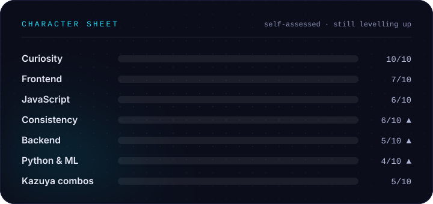</td>
    <td width="40%" valign="top"></td>
  </tr>
</table>

<!-- ───────────────────────── 03 · PROJECTS ───────────────────────── -->

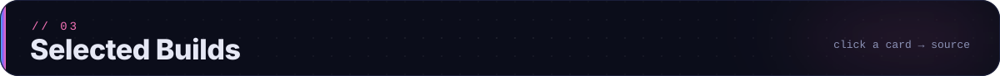

<table>
  <tr>
    <td width="50%"></td>
    <td width="50%"></td>
  </tr>
  <tr>
    <td width="50%"></td>
    <td width="50%"></td>
  </tr>
  <tr>
    <td width="50%"></td>
    <td width="50%"></td>
  </tr>
</table>

The repository is always the source of truth for current code and feature status. &nbsp;·&nbsp; <a href="https://github.com/Malik-Zain-555?tab=repositories"><b>Browse all repositories →</b></a>

<!-- ───────────────────────── 04 · ROADMAP ───────────────────────── -->

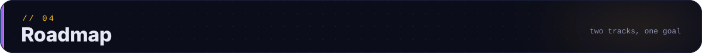

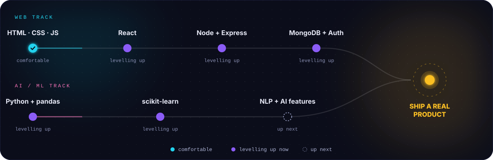

  
<b>📜 Open the quest log</b>

   

- [x] Build and clone interactive frontends with React, GSAP, Lenis, and Framer Motion
- [x] Build a server-rendered full-stack app with Express, EJS, and MySQL
- [x] Complete a baseline ML loop on the Titanic dataset (~79.9% test accuracy)
- [ ] Go deeper on React: state, effects, reusable components, and the *why* behind patterns
- [ ] Ship an auth-secured full-stack project: bcrypt, JWT, role middleware, email verification, password reset
- [ ] Practise ML consistently: stronger data prep, cross-validation, and better evaluation
- [ ] Deploy a project publicly and write down what I learned
- [ ] Turn a problem-first idea into my BSCS / FYP product

<!-- ───────────────────────── 05 · WORKSHOP ───────────────────────── -->

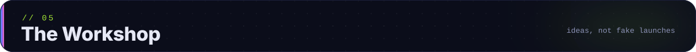

<table>
  <tr>
    <td width="33%" valign="top"></td>
    <td width="33%" valign="top"></td>
    <td width="33%" valign="top"></td>
  </tr>
</table>

<!-- ───────────────────────── 06 · STATS ───────────────────────── -->

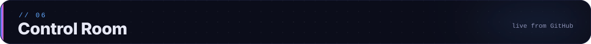

<picture>
  <source media="(prefers-color-scheme: dark)" srcset="https://raw.githubusercontent.com/Malik-Zain-555/Malik-Zain-555/output/github-snake-dark.svg" />
  <source media="(prefers-color-scheme: light)" srcset="https://raw.githubusercontent.com/Malik-Zain-555/Malik-Zain-555/output/github-snake.svg" />
  
</picture>

Stats come from third-party services; if one is briefly down, everything else here still works.

<!-- ───────────────────────── 07 · OUTSIDE ───────────────────────── -->

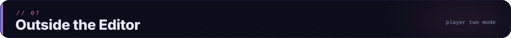

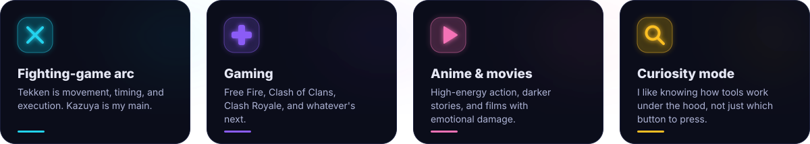

🧩 <b>Builder instinct:</b> I notice a small inconvenience and immediately think, “could I build something to fix that?”

 

<!-- ───────────────────────── 08 · CONNECT ───────────────────────── -->

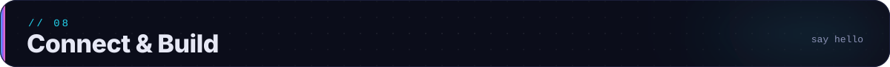

 

**Talk to me about** &nbsp;🌐 full-stack web &nbsp;·&nbsp; 🤖 practical AI/ML &nbsp;·&nbsp; 🎓 student & FYP ideas &nbsp;·&nbsp; 🥋 Tekken

 

  

  

<a href="#top">⬆ back to top</a>

