<!--
  ZAIN ALI — GitHub profile README ("Workbench")
  Generated by build_assets.py. Edit the DATA blocks there and re-run.
  Live parts (contribution log, play-a-round scoreboard) are redrawn by GitHub Actions.
-->


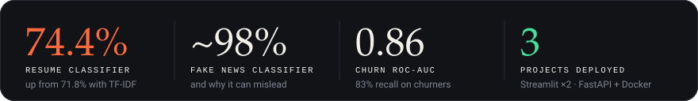

All numbers are from my own repos. Each build below says what they mean and where they fall short.

<b>Who's reading?</b> &nbsp;pick one and I'll take you to the right place

<a href="#builds">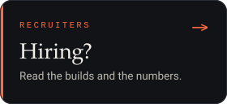</a>
<a href="#web">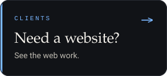</a>
<a href="#play">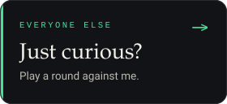</a>

<!-- ───────── 01 · ABOUT ───────── -->

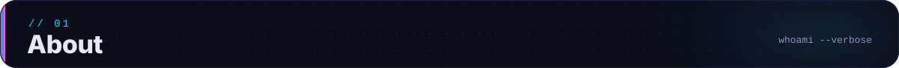

### Hi, I'm Zain. 👋

I'm a BS Computer Science student in Islamabad and an AI/ML intern at FlyRank. I started coding in August 2023 with HTML, CSS and JavaScript, spent a couple of years on frontend and animation, tried mobile and game development, and found my direction in 2026: Python in February, machine learning in June. Since then everything I build is ML, NLP and the engineering around it.

**My method is simple: I learn by building, not by theory.** No offense to theory, it just isn't how I learn. I pick a real problem, build the smallest version that works, measure it honestly, then go looking for where it breaks. That's why my fake-news classifier comes with an investigation into a "Reuters" shortcut instead of a victory lap around 98% accuracy.

I only want to build things that mean something and solve real problems, and the next ones are going to be bigger. Right now that's **Sahi Daam**, a fair-price detector for Pakistani house listings. After that I'm going deeper into ML and NLP, and later (inshallah) deep learning (ANN, CNN, RNN) and RAG, on the way to becoming an AI Engineer.

I also build with AI, openly. Concepts I design and use AI to code (anything TypeScript here, for example) sit in their own labelled section, and tutorial-guided work is marked as tutorial-guided.

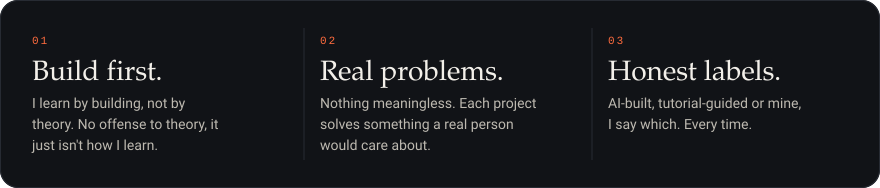

<b>At a glance</b>

 

<table>
<tr><td><b>Name</b></td><td>Zain Ali (online: Malik Zain)</td></tr>
<tr><td><b>Based in</b></td><td>Islamabad, Pakistan</td></tr>
<tr><td><b>Studying</b></td><td>BS Computer Science, Riphah International University</td></tr>
<tr><td><b>Working as</b></td><td>AI/ML Intern, FlyRank AI Internship Program (since mid-June 2026)</td></tr>
<tr><td><b>Before</b></td><td>Python internship at HexSoftwares</td></tr>
<tr><td><b>Freelance</b></td><td>Responsive landing pages (Fiverr)</td></tr>
<tr><td><b>Focus now</b></td><td>Going deeper into ML and NLP</td></tr>
<tr><td><b>Later</b></td><td>Deep learning (ANN, CNN, RNN) and RAG, inshallah</td></tr>
<tr><td><b>Goal</b></td><td>AI Engineer</td></tr>
<tr><td><b>Method</b></td><td>I learn by building, not by theory</td></tr>
<tr><td><b>Off the clock</b></td><td>Tekken (Kazuya main), games, anime and movies</td></tr>
</table>

<!-- ───────── 02 · BUILDS ───────── -->

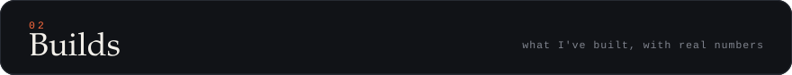

<a href="https://github.com/Malik-Zain-555/resume-category-classifier">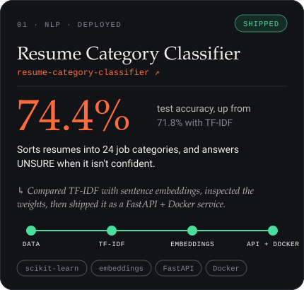</a>
<a href="https://github.com/Malik-Zain-555/fake_news_style_detector">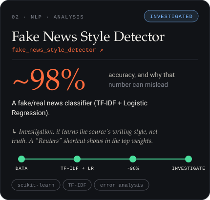</a>
<a href="https://github.com/Malik-Zain-555/churn-prediction-pipeline">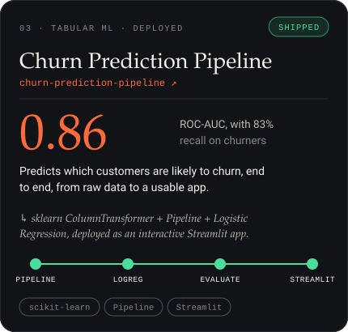</a>
<a href="https://github.com/Malik-Zain-555/EDA-Heart_Disease"></a>
<a href="https://github.com/Malik-Zain-555/MUDABBIR-FYP">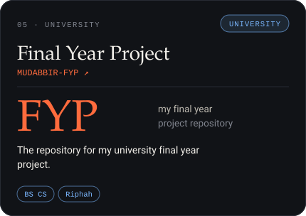</a>
<a href="https://github.com/Malik-Zain-555/Zylo">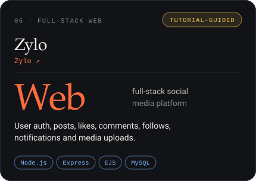</a>

Same order as my pinned repos. Click a card to open the repo. &nbsp;·&nbsp; <a href="https://github.com/Malik-Zain-555?tab=repositories"><b>All repositories →</b></a> More ML work lives in other repos: a Titanic survival app (Streamlit, 82.68% with Random Forest and Gradient Boosting) and my FlyRank internship notebooks.

<!-- ───────── 03 · NOW BUILDING ───────── -->

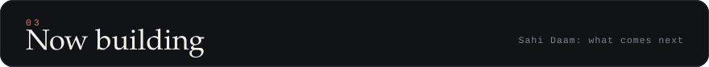

<a href="https://github.com/Malik-Zain-555/sahi-daam-fair-price-detector"></a>

<b>The plan behind Sahi Daam</b> (six weeks, in order)

 

The idea: <b>the model's mistakes become the product.</b> Most beginner projects stop at "predict the price". Sahi Daam goes one step further and uses the errors to find deals.

<table>
<tr><th>Week</th><th>Phase</th><th>Output</th></tr>
<tr><td>1</td><td>Set up and collect data</td><td>raw listings CSV</td></tr>
<tr><td>2</td><td>Clean the data</td><td>clean listings CSV and a cleaning log</td></tr>
<tr><td>3</td><td>Explore and engineer features</td><td>EDA notebook</td></tr>
<tr><td>4</td><td>Baseline and models</td><td>results table (baseline vs models)</td></tr>
<tr><td>5</td><td>Investigate errors and flag deals</td><td>error analysis, overpriced and bargain lists</td></tr>
<tr><td>6</td><td>Build the app and write the README</td><td>live Streamlit app, finished repo</td></tr>
</table>

 

I'm collecting house listings from Zameen.com, so cleaning messy units (marla, kanal, lakh, crore) is the first real test. I check the site's rules before collecting anything, keep requests polite, and never store personal data. The final repo will carry a results table against a simple baseline, an error analysis ("where the model fails"), and a Streamlit app.

<!-- ───────── 04 · CONCEPT LAB ───────── -->

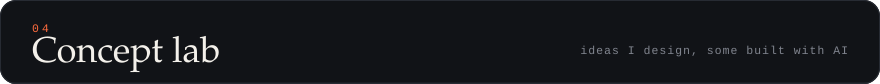


<b>Built with AI, from my concepts</b>

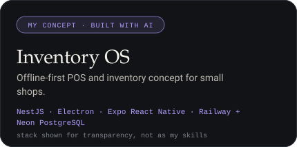
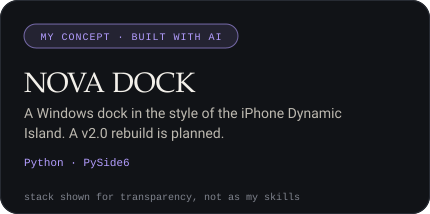

I come up with the concept and the problem; AI writes most of the code. Anything TypeScript on my profile falls in this bucket. More ideas on my list: a bill splitter and a monthly budget tracker.

<!-- ───────── 05 · STACK ───────── -->

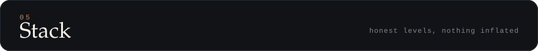
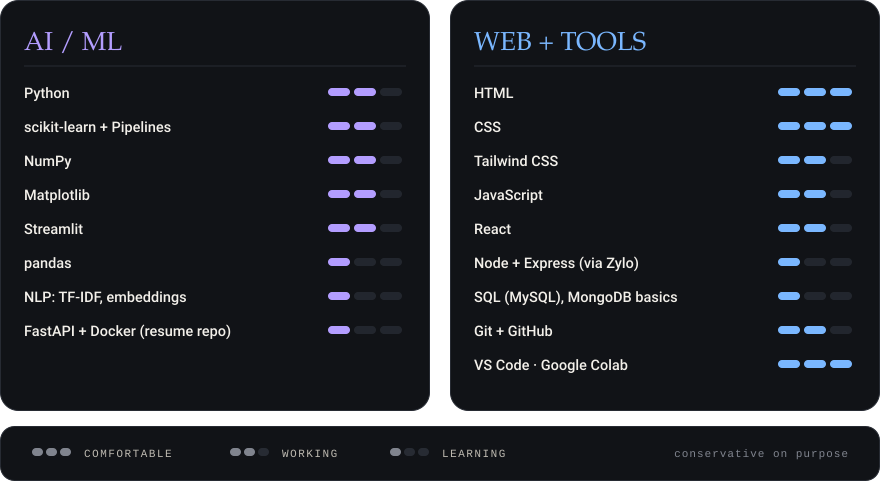

Not listed on purpose: tools I've only met in courses or built with AI help (for example NestJS, AWS, Kubernetes). They appear on the labelled AI-built cards instead.

<b>Web work</b> (where I started: tutorial-guided, clones and practice)

 

<table>
<tr><th>Project</th><th>How it was made</th><th>Stack</th></tr>
<tr><td><a href="https://github.com/Malik-Zain-555/Zylo">Zylo</a></td><td>Tutorial-guided</td><td>Node.js, Express, EJS, MySQL</td></tr>
<tr><td><a href="https://github.com/Malik-Zain-555/Ochi-website-Clone">Ochi website clone</a></td><td>Clone</td><td>React, GSAP</td></tr>
<tr><td><a href="https://github.com/Malik-Zain-555/Grid-ScrollAnimation-using-Lenis">Grid scroll animation</a></td><td>Practice</td><td>JavaScript, GSAP, Lenis</td></tr>
<tr><td><a href="https://github.com/Malik-Zain-555/twogood_website_clone">Two Good website clone</a></td><td>Clone</td><td>HTML, CSS, JavaScript</td></tr>
<tr><td><a href="https://github.com/Malik-Zain-555/Bubble-Game">Bubble Game</a></td><td>Practice</td><td>JavaScript, HTML, CSS</td></tr>
<tr><td><a href="https://github.com/Malik-Zain-555/LMS">Library Management System</a></td><td>University project</td><td>Java, MySQL</td></tr>
</table>

I also freelance, building responsive landing pages (Fiverr).

<!-- ───────── 06 · JOURNEY ───────── -->

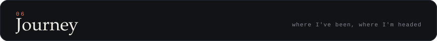
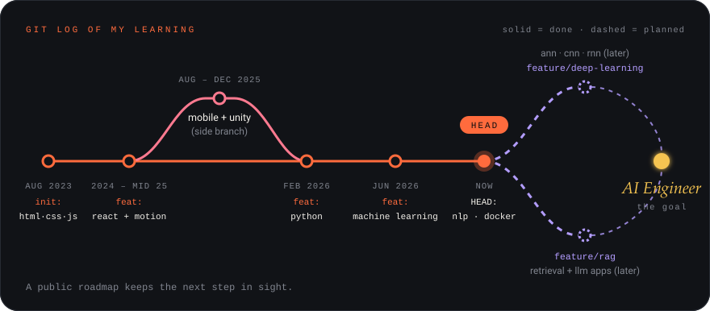

<b>Now · NLP, going deeper</b>

 

<table>
<tr><td><b>Learn deeply</b></td><td>Text representations (TF-IDF vs embeddings), evaluation beyond accuracy (precision, recall, error analysis), reading model weights</td></tr>
<tr><td><b>Understand lightly</b></td><td>How transformer models work</td></tr>
<tr><td><b>Skip for now</b></td><td>Training big models from scratch (no GPU, so Colab if ever needed)</td></tr>
<tr><td><b>Checkpoint</b></td><td>A grammar and punctuation error explainer: finds mistakes and says why</td></tr>
<tr><td><b>If I skip this</b></td><td>Deep learning and RAG both build on text representations. Skipping means copying code I can't debug.</td></tr>
<tr><td><b>Next single step</b></td><td>Start the grammar and punctuation explainer: collect examples of mistakes and the rule behind each</td></tr>
</table>

<b>Later · Deep learning</b> (ANN, CNN, RNN)

 

<table>
<tr><td><b>Learn deeply</b></td><td>ANN basics and backpropagation intuition, CNNs for images, RNNs for sequences</td></tr>
<tr><td><b>Understand lightly</b></td><td>Transformers and attention</td></tr>
<tr><td><b>Skip for now</b></td><td>Custom GPU code, training large models from scratch</td></tr>
<tr><td><b>Checkpoint</b></td><td>A small CNN on an image dataset and a small RNN on text, each explained in my own words</td></tr>
<tr><td><b>If I skip this</b></td><td>I'd stay a classic-ML person who can't explain why modern models work.</td></tr>
</table>

<b>Later · RAG apps</b>

 

<table>
<tr><td><b>Learn deeply</b></td><td>Embeddings, chunking, vector search, and how to evaluate answers</td></tr>
<tr><td><b>Understand lightly</b></td><td>Agent frameworks</td></tr>
<tr><td><b>Skip for now</b></td><td>Training LLMs</td></tr>
<tr><td><b>Checkpoint</b></td><td>A small RAG app over documents I choose, with a written evaluation</td></tr>
<tr><td><b>If I skip this</b></td><td>I'd be able to classify text but not build the retrieval apps people ask for today.</td></tr>
</table>

<b>Already cleared</b> (what's solid, what's still shaky)

 

<table>
<tr><th>Stage</th><th>Solid</th><th>Still shaky</th></tr>
<tr><td>HTML · CSS · JS</td><td>HTML, CSS, Tailwind basics; I love JavaScript</td><td>Advanced JavaScript is rusty</td></tr>
<tr><td>React basics</td><td>I can build sites</td><td>The concepts underneath aren't deep yet</td></tr>
<tr><td>Python</td><td>Python since Feb 2026, NumPy, Matplotlib</td><td>pandas is partial</td></tr>
<tr><td>ML fundamentals</td><td>scikit-learn, Pipelines, Logistic Regression, Random Forest, Gradient Boosting</td><td>Evaluation depth, which is what the NLP stage trains</td></tr>
<tr><td>Deployment</td><td>FastAPI + Docker, done once in the resume classifier repo; Streamlit apps</td><td>Only done once so far</td></tr>
</table>

<!-- ───────── 07 · CONTRIBUTION LOG ───────── -->

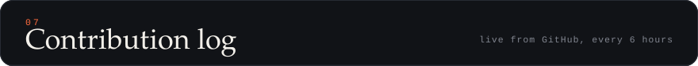
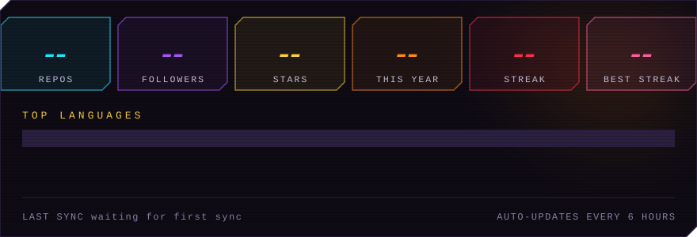
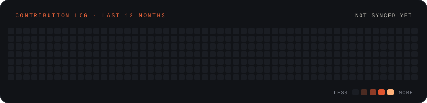

<!-- ───────── 08 · PLAY ───────── -->

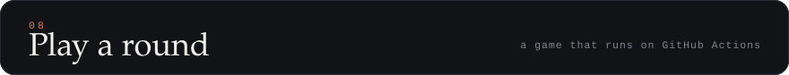

<!-- CHALLENGE-ZAIN:START -->

<b>Pick a move. A GitHub Action plays the round against me and updates the scoreboard.</b> 
STRIKE beats THROW · THROW beats GUARD · GUARD beats STRIKE

<a href="https://github.com/Malik-Zain-555/Malik-Zain-555/issues/new?title=fight%7Cstrike&body=Just+press+%22Submit+new+issue%22.+Don%27t+change+the+title%3A+the+arcade+bot+plays+your+round+and+replies+here.">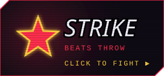</a>
<a href="https://github.com/Malik-Zain-555/Malik-Zain-555/issues/new?title=fight%7Cthrow&body=Just+press+%22Submit+new+issue%22.+Don%27t+change+the+title%3A+the+arcade+bot+plays+your+round+and+replies+here.">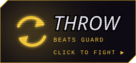</a>
<a href="https://github.com/Malik-Zain-555/Malik-Zain-555/issues/new?title=fight%7Cguard&body=Just+press+%22Submit+new+issue%22.+Don%27t+change+the+title%3A+the+arcade+bot+plays+your+round+and+replies+here.">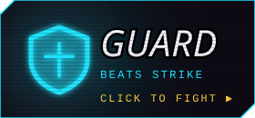</a>

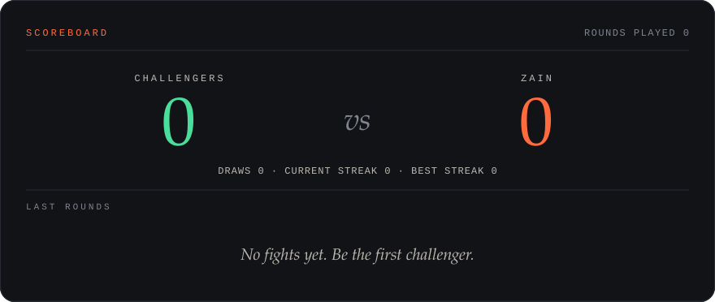

<!-- CHALLENGE-ZAIN:END -->

<b>How does this work?</b>

 

Clicking a move opens a pre-filled GitHub issue. Press <b>Submit new issue</b> (you need a GitHub account). A GitHub Action picks my move at random, decides the winner, comments the result on your issue, closes it, and redraws the scoreboard above. It can take a minute or two to refresh because GitHub caches images. Code: <a href="https://github.com/Malik-Zain-555/Malik-Zain-555/blob/main/.github/scripts/fight.py"><code>.github/scripts/fight.py</code></a>.

<!-- ───────── 09 · OFF THE CLOCK ───────── -->
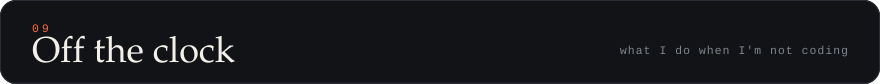
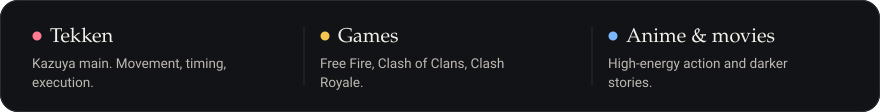

 

<!-- ───────── CONNECT ───────── -->

<b>Want to talk, collaborate or tell me my model is overfitting?</b>

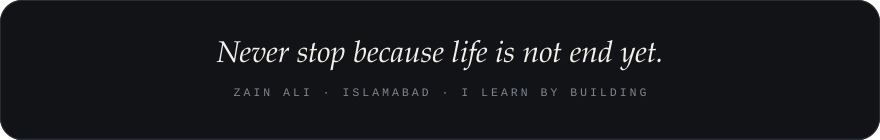

<a href="#top">⬆ back to top</a>

