<!--
  Malik Zain: GitHub profile README. Generated by build_assets.py (edit the DATA block there, run it, push).
  The design is the portfolio page redrawn as SVG tiles; the "Live from GitHub" tile is redrawn by a GitHub Action.
  Fonts: Unbounded and Hanken Grotesk (SIL Open Font License), embedded in the SVGs.
-->


       


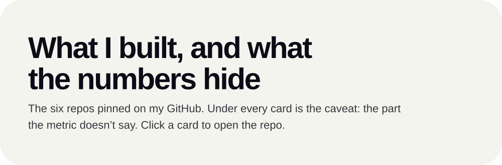
<a href="https://github.com/Malik-Zain-555/sahi-daam-fair-price-detector">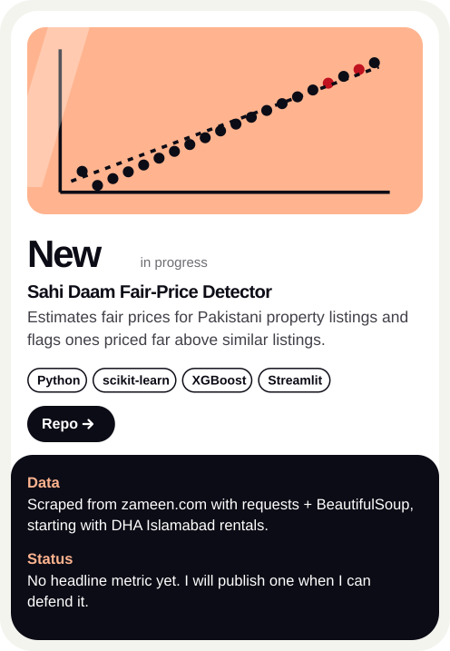</a>
<a href="https://github.com/Malik-Zain-555/resume-category-classifier">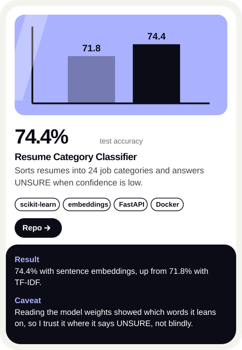</a>
<a href="https://github.com/Malik-Zain-555/fake_news_style_detector">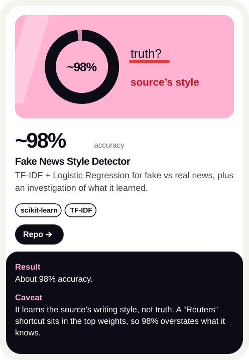</a>
<a href="https://github.com/Malik-Zain-555/churn-prediction-pipeline">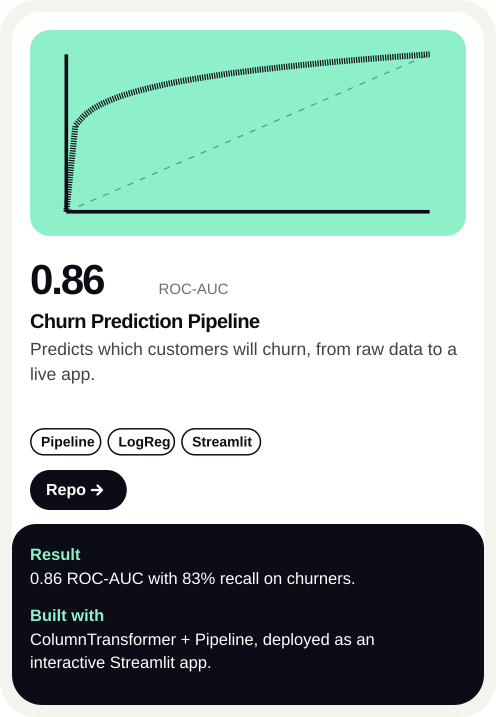</a>
<a href="https://github.com/Malik-Zain-555/MUDABBIR-FYP">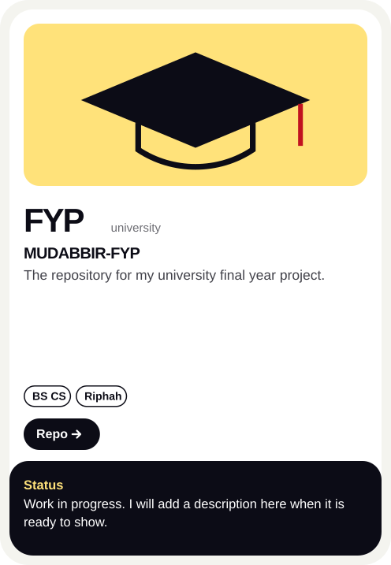</a>
<a href="https://github.com/Malik-Zain-555/Zylo">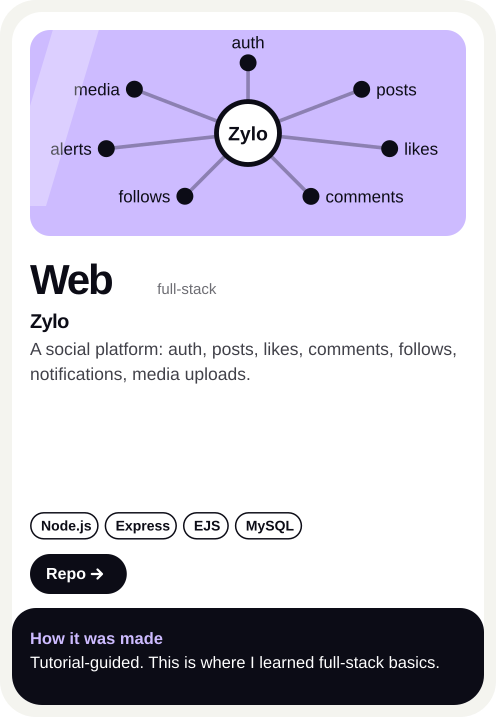</a>

 



<b>Open every stop</b> (solid, still shaky, checkpoint)

 

<table>
<tr><th>Stop</th><th>When</th><th>Solid / learning deeply</th><th>Still shaky / skipping for now</th><th>Checkpoint</th></tr>
<tr><td><b>HTML, CSS, JS</b></td><td>Aug 2023</td><td>Solid on HTML, CSS and Tailwind basics. I love JavaScript.</td><td>Advanced JavaScript is rusty.</td><td>Revisit it when a build needs it.</td></tr>
<tr><td><b>React</b></td><td>2024 to mid 2025</td><td>I can build React sites, with a lot of frontend and animation work.</td><td>The concepts underneath are not deep yet.</td><td>Go deeper, until my ML apps need a real front end.</td></tr>
<tr><td><b>Python</b></td><td>Feb 2026</td><td>Python, NumPy, Matplotlib. pandas is partial.</td><td>Heavy data wrangling.</td><td>Own CLI tools and scripts.</td></tr>
<tr><td><b>Machine learning</b></td><td>Jun 2026</td><td>scikit-learn, Pipelines, Logistic Regression, tree models. Interning at FlyRank.</td><td>Training big models from scratch.</td><td>Six repos with honest numbers.</td></tr>
<tr><td><b>NLP</b></td><td>Now</td><td>TF-IDF vs embeddings, evaluation beyond accuracy, reading model weights.</td><td>Training transformers: no GPU, so Colab if ever.</td><td>A grammar and punctuation error explainer.</td></tr>
<tr><td><b>Deep learning</b></td><td>Later, inshallah</td><td>ANN basics, CNNs for images, RNNs for sequences.</td><td>Custom GPU code.</td><td>A small CNN and RNN explained in my own words.</td></tr>
<tr><td><b>RAG apps</b></td><td>Later, inshallah</td><td>Embeddings, chunking, vector search, evaluating answers.</td><td>Training LLMs.</td><td>A small RAG app over documents I choose, with a written evaluation.</td></tr>
</table>

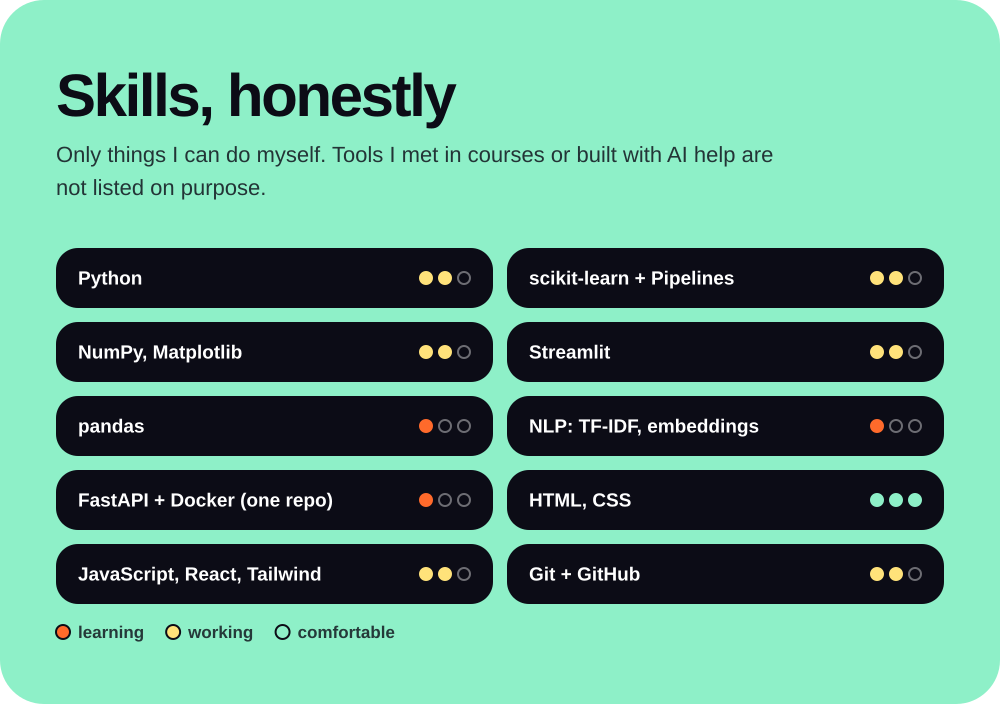




  

Built by hand. Generated by <code>build_assets.py</code>; the live tile is redrawn by a GitHub Action.

Plain-text version

 

**Malik Zain.** BS CS student at Riphah and AI/ML intern at FlyRank, in Islamabad. I learn by building, not by theory. I build small machine-learning projects, then measure where they break.

Now: NLP. Building: Sahi Daam. Later, inshallah: deep learning, RAG.

- [Sahi Daam Fair-Price Detector](https://github.com/Malik-Zain-555/sahi-daam-fair-price-detector) · New in progress. Estimates fair prices for Pakistani property listings and flags ones priced far above similar listings.
- [Resume Category Classifier](https://github.com/Malik-Zain-555/resume-category-classifier) · 74.4% test accuracy. Sorts resumes into 24 job categories and answers UNSURE when confidence is low.
- [Fake News Style Detector](https://github.com/Malik-Zain-555/fake_news_style_detector) · ~98% accuracy. TF-IDF + Logistic Regression for fake vs real news, plus an investigation of what it learned.
- [Churn Prediction Pipeline](https://github.com/Malik-Zain-555/churn-prediction-pipeline) · 0.86 ROC-AUC. Predicts which customers will churn, from raw data to a live app.
- [MUDABBIR-FYP](https://github.com/Malik-Zain-555/MUDABBIR-FYP) · FYP university. The repository for my university final year project.
- [Zylo](https://github.com/Malik-Zain-555/Zylo) · Web full-stack. A social platform: auth, posts, likes, comments, follows, notifications, media uploads.

[GitHub](https://github.com/Malik-Zain-555) · [LinkedIn](https://www.linkedin.com/in/malikzain555/) · [itch.io](https://zikakito.itch.io/)

