<!--
  ZAIN ALI — GitHub profile README (v3 · "Arcade")
  Repo: https://github.com/Malik-Zain-555/Malik-Zain-555
  Needs in the repo root: README.md, assets/, game/, .github/ (scripts + 2 workflows).
  All graphics are generated by build_assets.py. Live parts (stats, heatmap, scoreboard) are redrawn by GitHub Actions.
-->

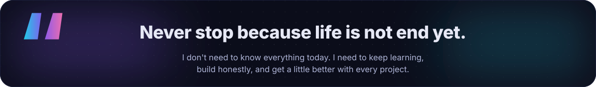

<a href="#projects"></a>
<a href="#moves"></a>
<a href="#arena"></a>

 

<!-- ─────────────── 01 · PLAYER PROFILE ─────────────── -->

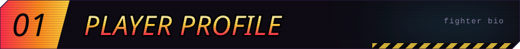

I'm a BSCS student who likes building for the web, working out how things behave behind the UI, and turning everyday annoyances into ideas for useful software. JavaScript is home base. React, Node, Express and MongoDB are where I'm digging in now, and Python, data analysis and ML are the next skill tree.

I'd rather show real progress than a perfect-looking tech list, so everything on this page is labelled for where I actually am.

<!-- ─────────────── 02 · MOVE LIST ─────────────── -->

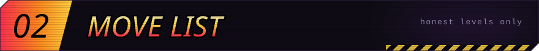

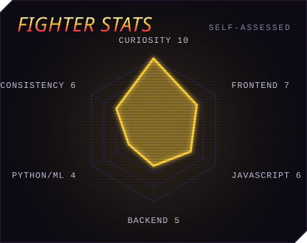
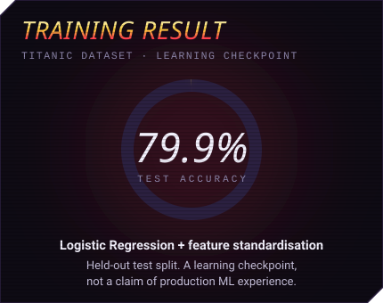

<!-- ─────────────── 03 · STAGE SELECT ─────────────── -->

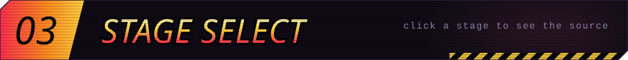

<a href="https://github.com/Malik-Zain-555/Zylo">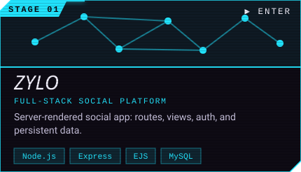</a>
<a href="https://github.com/Malik-Zain-555/LMS">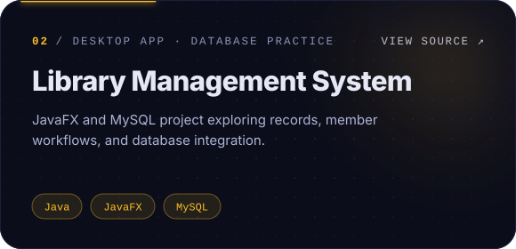</a>
<a href="https://github.com/Malik-Zain-555/Ochi-website-Clone">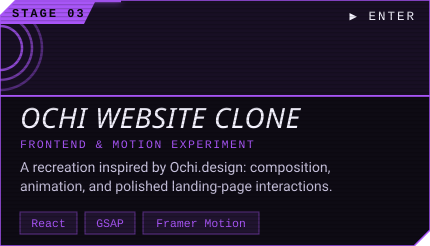</a>
<a href="https://github.com/Malik-Zain-555/Grid-ScrollAnimation-using-Lenis">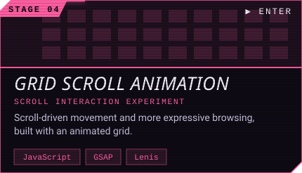</a>
<a href="https://github.com/Malik-Zain-555/twogood_website_clone">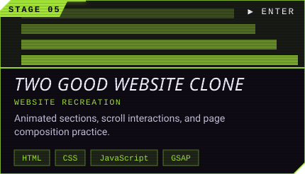</a>
<a href="https://github.com/Malik-Zain-555/Bubble-Game">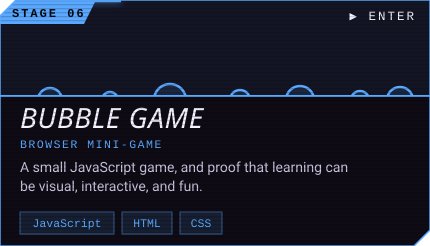</a>

The repo is always the source of truth for what's actually built. &nbsp;·&nbsp; <a href="https://github.com/Malik-Zain-555?tab=repositories"><b>Browse all repos →</b></a>

<!-- ─────────────── 04 · ARCADE LADDER ─────────────── -->

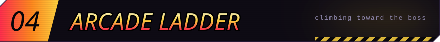
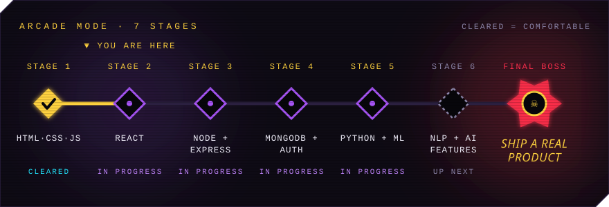

<b>Open the quest log</b>

 

- [x] Build and clone interactive frontends with React, GSAP, Lenis and Framer Motion
- [x] Build a server-rendered full-stack app with Express, EJS and MySQL
- [x] Complete a baseline ML loop on the Titanic dataset (~79.9% test accuracy)
- [ ] Go deeper on React: state, effects, reusable components, and the *why* behind patterns
- [ ] Ship an auth-secured full-stack project: bcrypt, JWT, role middleware, email verification, password reset
- [ ] Practise ML consistently: stronger data prep, cross-validation, better evaluation
- [ ] Deploy a project publicly and write down what I learned
- [ ] Turn a problem-first idea into my BSCS / FYP product

<!-- ─────────────── 05 · TRAINING MODE ─────────────── -->

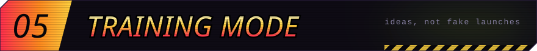

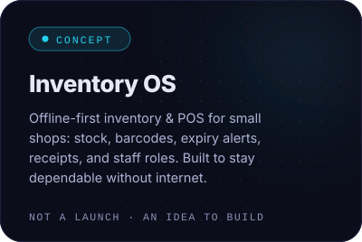
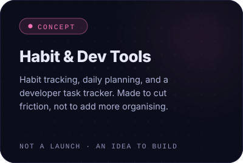
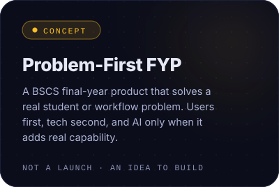

<!-- ─────────────── 06 · BATTLE LOG ─────────────── -->

<!-- ─────────────── 07 · CHALLENGE ZAIN ─────────────── -->

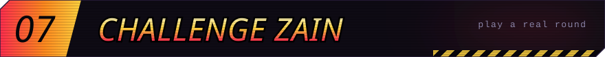

**Pick a move. A GitHub Action plays the round against me and updates the scoreboard.** &nbsp;🥋 
STRIKE beats THROW · THROW beats GUARD · GUARD beats STRIKE

<b>How does this work?</b>

 

Clicking a move opens a pre-filled GitHub issue. Press **Submit new issue** (you need a GitHub account) and a GitHub Action picks my move at random, decides the winner, comments the result on your issue, closes it, and redraws the scoreboard above. The scoreboard can take a minute or two to refresh because GitHub caches images. The full code is in [`.github/scripts/fight.py`](https://github.com/Malik-Zain-555/Malik-Zain-555/blob/main/.github/scripts/fight.py).

<!-- ─────────────── 08 · PLAYER 2 MODE ─────────────── -->

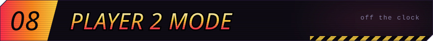
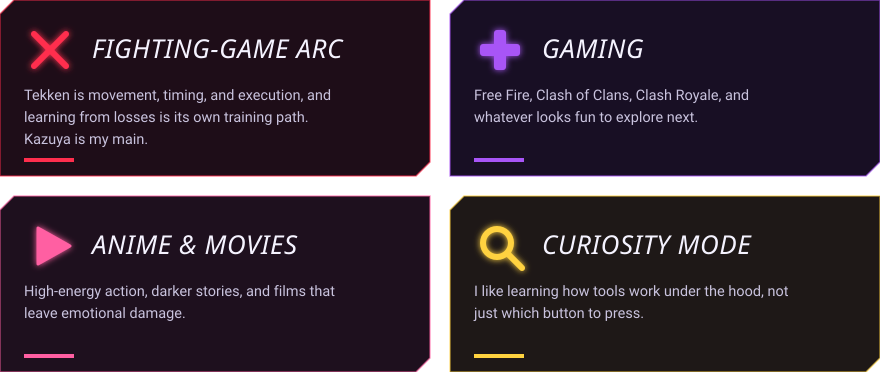

 

<!-- ─────────────── CONTINUE? ─────────────── -->


 

<a href="#top">⬆ back to top</a>

